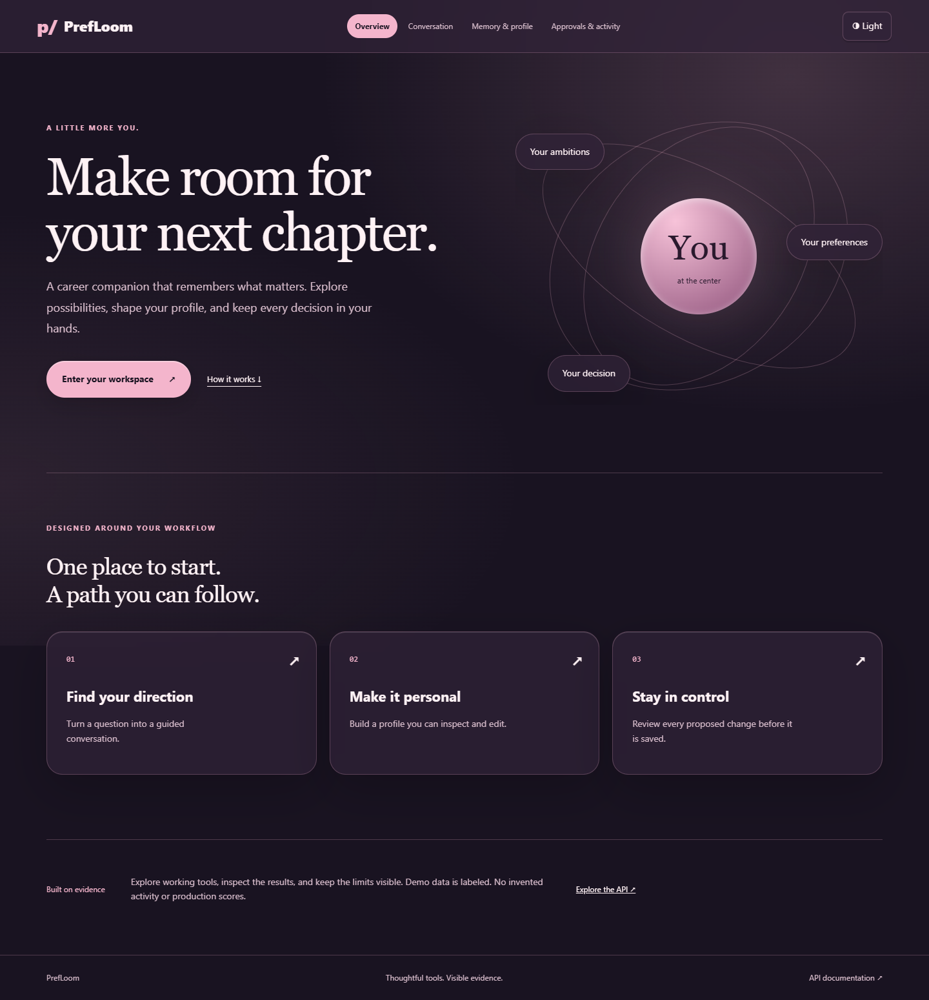
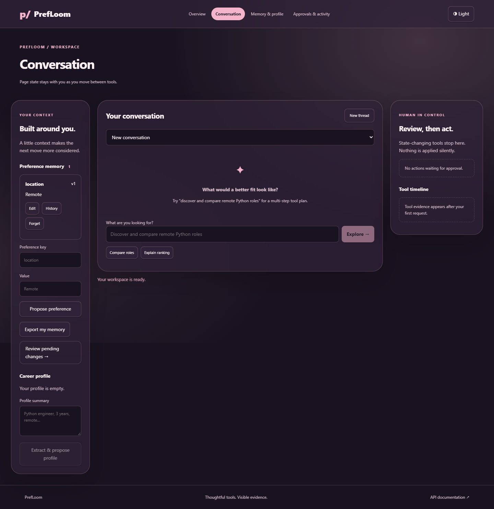
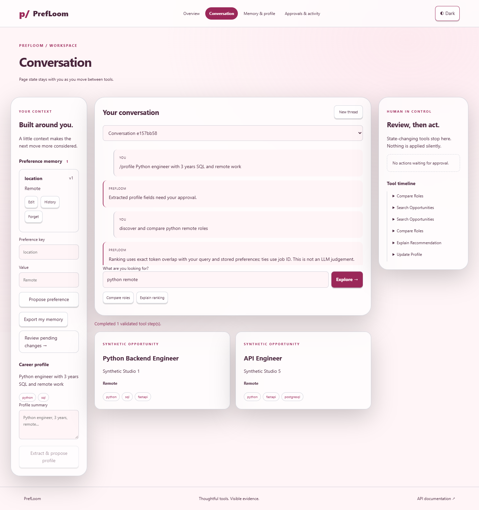
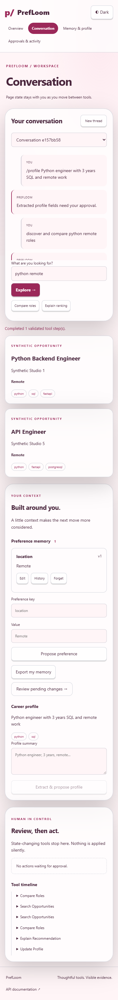
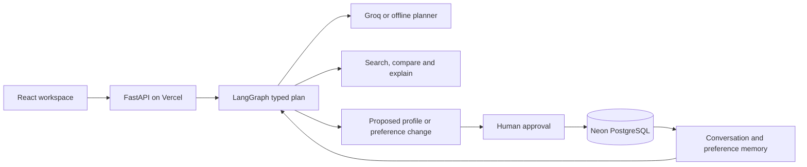
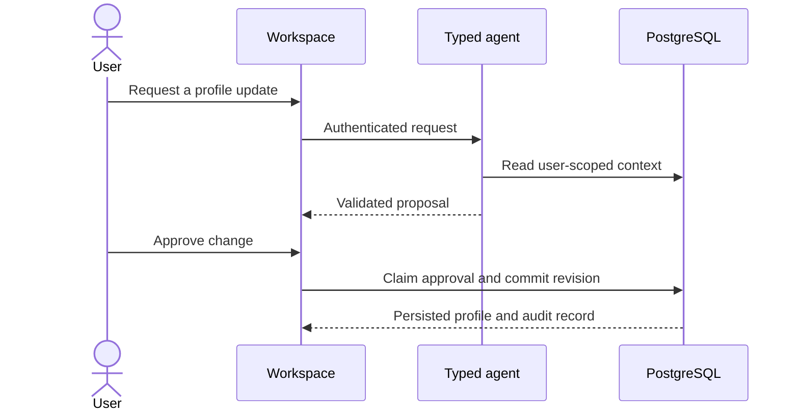

# PrefLoom

### A career workspace that remembers your preferences and asks before it acts.

[](https://github.com/Kanishkar843/PrefLoom/actions/workflows/checks.yml)

**[Live application ↗](https://prefloom.vercel.app) · [Interactive API](https://prefloom.vercel.app/docs) · [Verification report](docs/CLOUD_DELIVERY.md) · [Review PR](https://github.com/Kanishkar843/PrefLoom/pull/1)**

PrefLoom combines multi-step agent planning, persistent conversation memory and human-approved actions. A React and TypeScript interface makes preferences, proposed changes and tool execution visible; FastAPI, LangGraph and PostgreSQL keep the workflow typed and auditable.

## Interface redesign

A rose-and-plum glass interface with a dedicated landing page and separate Conversation, Memory & profile, and Approvals & activity pages. Navigation preserves workspace state; the original approval and persistence workflows remain available.



## Production preview



Captured from the redesigned application deployed on 25 November 2026. The galleries below show separately captured local test journeys.

<details>
<summary>View light theme and mobile screenshots</summary>

### Light theme — local browser test



### Mobile layout — local browser test



</details>

## Capabilities

- **Multi-step planning:** Groq-backed structured plans with one to five validated tool calls, plus deterministic offline mode.
- **Persistent context:** conversations, preference revisions, semantic profile extraction and user-scoped SQL memory.
- **Human approval:** state-changing actions remain proposals until approved; concurrent approvals apply a change only once.
- **Transparent discovery:** synthetic opportunity search, role comparison and deterministic ranking explanations.
- **Usable workspace:** streaming responses, tool timelines, editable memory, responsive layouts and dark/light themes.

## Scores and verification

**Evidence snapshot: 24 November 2026.** Scores describe the recorded runs, not a live uptime or quality guarantee.

| Verification | Recorded result |
|---|---|
| Live Groq planning | Search → compare → explain: **3 validated steps** |
| Typed plan bound | **1–5 tool calls** per plan |
| Semantic profile extraction | Structured profile proposal returned; write deferred |
| Human approval and persistence | Approved preference survived browser reload |
| Concurrency and ownership | Exactly-once approval and session isolation tested |

These are workflow verification results, not a model-accuracy benchmark. Opportunity listings are synthetic; ranking is deterministic even when planning uses an LLM.

### Engineering checks

| Check | Verified result |
|---|---|
| Backend unit tests | **10 passed** |
| Frontend unit tests | **4 passed** |
| Real-service integration | **Passed** — PostgreSQL |
| TypeScript / ESLint / production build | **Passed** |
| Browser journeys | **Passed** — local and deployed workflows |
| Docker Compose | **Passed** — build, readiness and restart acceptance |
| Recorded GitHub acceptance run | [**Passed**](https://github.com/Kanishkar843/PrefLoom/actions/runs/45410152964) |

[Detailed test evidence](docs/TEST_REPORT.md) · [Cloud checks and limitations](docs/CLOUD_DELIVERY.md) · [Resume-claim verification](docs/RESUME_VERIFICATION.md)

## Architecture





## Run locally

Use Python 3.12 and Node 22 for the documented local workflow. Run one project stack at a time.

```powershell
cd K:\Projects\PrefLoom
py -3.12 -m venv .venv
.\.venv\Scripts\python.exe -m pip install -r requirements.lock
npm ci --prefix frontend
npm run build --prefix frontend
.\.venv\Scripts\python.exe -m uvicorn app.main:app --host 127.0.0.1 --port 8000
```

Open http://127.0.0.1:8000. Create a session, explore synthetic roles, propose a preference or profile update, approve it, then reload to inspect persisted memory.

The API serves the compiled React frontend; `/docs` exposes OpenAPI and `/legacy` preserves the original interface. Native defaults use SQLite for an explicit local demo. To use PostgreSQL, configure `DATABASE_URL`, then run `python -m alembic upgrade head`. For frontend development, use `npm run dev --prefix frontend` with the API running.

## Configuration

| Variable | Purpose |
|---|---|
| `DATABASE_URL` | PostgreSQL URL; defaults to local SQLite for the native demo |
| `AGENT_MODE` | `offline` (default) or `provider` |
| `LLM_BASE_URL` | Provider base URL; deployed configuration uses `https://api.groq.com/openai/v1` |
| `LLM_MODEL` | Deployed provider: `openai/gpt-oss-20b` |
| `LLM_API_KEY` | Server-side provider credential |
| `POSTGRES_PASSWORD` | Required Compose database secret |

Keep credentials in environment variables or ignored `.env` files. Never put provider keys, database credentials or operator tokens in frontend build variables or Git.

## Deployment

The live frontend and backend share one Vercel project. `vercel.json` builds React, copies assets to `public`, and deploys the FastAPI entrypoint. Neon provides PostgreSQL; the configured integrations use free plans.

```powershell
# From the linked project, after configuring production secrets and migrations:
vercel deploy --prod --scope kanishkar843s-projects
```

For local containers, configure the required `.env` values, then:

```powershell
docker compose up --build -d --wait
docker compose down
```

Omit `-v` when stopping containers to retain database data. Windows virtual environments cannot be reused inside WSL; use containers or create a Linux environment. See [Windows/Docker setup](docs/DEPLOYMENT.md) and [Vercel configuration](docs/CLOUD_DELIVERY.md).

## Reproduce the checks

```powershell
.\.venv\Scripts\python.exe -m pytest -q tests
npm run typecheck --prefix frontend
npm run lint --prefix frontend
npm test --prefix frontend
npm run build --prefix frontend
.\.venv\Scripts\python.exe -m pytest -q integration
.\.venv\Scripts\python.exe tests/browser_journey.py
```

The integration suite requires an isolated real PostgreSQL `TEST_DATABASE_URL`; it never substitutes SQLite. The local browser harness owns a temporary fixture server. Production browser evidence is recorded separately in the cloud report.

## Known limits

- The deployed planner uses Groq; local offline mode requires no provider credentials.
- Opportunity data is synthetic, not a live job feed. No recommendation-accuracy score is claimed.
- Session bearer credentials are user-scoped; rate limiting is per function instance, not a distributed quota.
- Provider errors and free-tier limits can interrupt requests; human approval remains mandatory for writes.

## Documentation and provenance

[Architecture](docs/ARCHITECTURE.md) · [Database schema](docs/DATABASE_ERD.md) · [API reference](docs/API_REFERENCE.md) · [Environment](docs/ENVIRONMENT_REPORT.md) · [Security](docs/SECURITY.md) · [Dependencies and attribution](docs/DEPENDENCIES_AND_ATTRIBUTION.md) · [Original specification](docs/MASTER_PROMPT.md)

First-party application code, interface designs and fixtures are original to this project. Dependencies and model artifacts retain their third-party notices. No first-party project license has been selected.

Development is published on `feat/verified-agent-react` through [PR #1](https://github.com/Kanishkar843/PrefLoom/pull/1), preserving existing `main` history. Deployment status, software acceptance and evaluated-model quality are reported separately.

[Frontend redesign and verification](docs/FRONTEND_REDESIGN.md)
