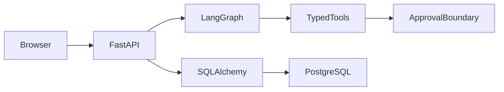

# PrefLoom architecture

A career workspace with SQL-backed preference memory and human-approved typed actions.

The API and UI share one origin, eliminating a separate frontend service for the local demo. FastAPI serves original static assets; SQLAlchemy manages database connections. SQLite is only the explicitly labeled native fallback. PostgreSQL deployment paths are present but unverified.

## Tradeoffs

Synchronous bounded work keeps resource use modest, at the cost of durable worker execution and multi-instance coordination. Fixture mode makes tests reproducible without credentials. This does not validate an LLM or a semantic embedding model. Production schema, authentication, concurrency and service integration require the remaining acceptance checks.

## Source map

`app/main.py`: REST and UI entry points. Domain logic is in `app/agent.py` + `app/db.py` (PrefLoom), `app/core.py` + `app/store.py` (DeltaIndex), or `app/metrics.py` + `app/engine.py` (EvalTrace). `tests/`: executable native checks. `migrations/`: initial Alembic entry point.
