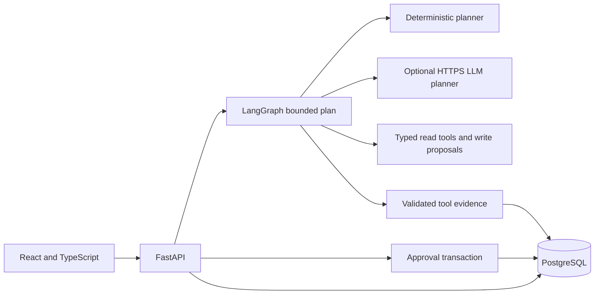
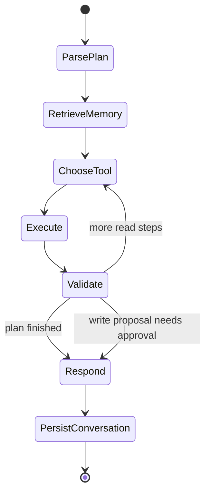
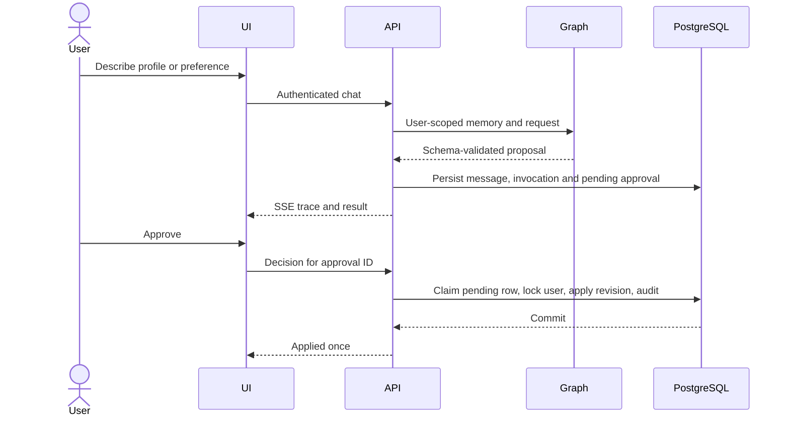

# PrefLoom architecture

PrefLoom separates planning from authorized state changes. Both the deterministic planner and optional provider planner return a Pydantic `ToolPlan` of at most five calls. LangGraph executes read tools in sequence and stops as soon as a call proposes a write. The approval endpoint claims a pending request transactionally, serializes changes for the user, applies the change, and writes an audit event in the same transaction.

## Persistence and isolation

Tables include users, career_profiles, preference_facts, conversation_threads, messages, tool_invocations, approval_requests, audit_events, memory_revisions and session_leases. Tokens are random and only their SHA-256 digests are stored. New sessions expire after seven days and can be revoked. User ownership filters are applied to threads, memories, approvals and traces. Forgetting deletes current memory and its version history; the audit retains only the fact ID.

Migrations contain frozen operations independent of runtime models. Native SQLite remains an explicitly labeled convenience mode. PostgreSQL integration evidence is reported separately and is never inferred from SQLite tests.

## Provider contract

Set AGENT_MODE=provider, LLM_BASE_URL, LLM_MODEL and LLM_API_KEY. The adapter performs actual HTTPS inference using the OpenAI-compatible chat-completions protocol with JSON Schema output. A maximum of three attempts and per-request connect/read timeouts bound failures. No provider response can grant approval. Provider-produced profile fields are validated and stored only after the user approves. Provider failures produce a sanitized 503 response. The test suite mocks provider transport; live execution requires supplied credentials and is marked separately.

## Deliberate limits

The offline planner uses explicit deterministic rules and synthetic jobs. It is not an LLM simulation presented as live inference. The demo has no external action tools. SSE carries actual trace/result events; it does not expose private model reasoning. Multi-instance rate limiting and consumer identity verification are outside this local demo's auth scope. The UI and API share one origin and no heavyweight worker infrastructure is needed.
