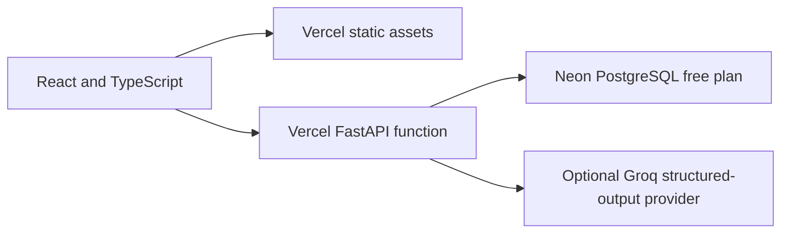

# Cloud delivery — 2026-11-24

Live application: https://prefloom.vercel.app

Live Groq GPT-OSS 20B planning is enabled. A real request produced search, compare and explanation steps; natural-language profile extraction produced a typed proposal. State changes remain behind human approval. Opportunity data is synthetic and ranking remains deterministic.

## Architecture



## Verified evidence

- Public health and readiness: HTTP 200, PostgreSQL and provider-backed mode.
- Live three-step Groq plan and semantic profile proposal: passed; writes deferred.
- Browser preference proposal, human approval, persisted memory after reload: passed.
- Backend: 10 tests passed; correctness lint passed. Frontend mode now reads server health on connection.
- Rate limiting is per function instance, not a distributed production quota. Synthetic opportunities are not a live job feed.

All three applications passed actual Chrome production smoke journeys. Screenshots in docs/assets/production-desktop.png were captured from live deployments with secret fields cleared. Earlier local/Docker/CI evidence remains in TEST_REPORT.md; those checks are not relabeled as cloud checks.

The initial production browser harness expected DeltaIndex search results before submitting a query; this assertion failed. The harness now submits Search, and the rerun passed. Initial Vercel builds required flattening requirements.txt rather than including the runtime lock with -r.

## Reproduce deployment

Use Node, Python 3.12, authenticated Vercel CLI and the existing linked project. Never commit .env files or .vercel metadata.

```powershell
npm ci --prefix frontend
npm run build --prefix frontend
# Apply Alembic against the selected PostgreSQL database before deploying.
.\.venv\Scripts\python.exe -m alembic upgrade head
vercel deploy --prod --scope kanishkar843s-projects
```

vercel.json builds React and copies static assets into public; app/main.py is the FastAPI entrypoint. DATABASE_URL accepts Neon postgres/postgresql URLs and selects the psycopg driver. requirements.txt pins cloud runtime dependencies; requirements.lock retains native development dependencies.

Neon resources use free_v3; Upstash uses free with automatic paid upgrade disabled. No paid plan was enabled. Provider and database credentials remain in Vercel environment variables and ignored local files. Account quota availability is not a performance guarantee.

## Access and limitations

Sessions use individual bearer credentials stored by the browser. Provider planning is optional; AGENT_MODE=offline preserves deterministic local testing. Free-tier provider rate limits may return bounded errors.
