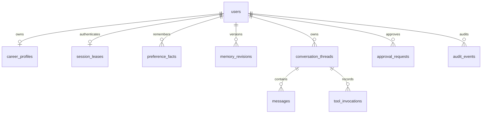

# PostgreSQL schema

Alembic `0001` freezes the original eight tables; `0002` adds session expiry/revocation and memory revision history. PostgreSQL startup requires migrations; SQLite creates schema only for the explicit native demo.

UUID strings identify entities. `users.token_hash` is unique and stores SHA-256 of a random bearer token, never its plaintext. Profile and tool payloads are JSON. Foreign keys and user/thread indexes scope reads. Facts have unique `(user_id,key)`; revisions have unique `(fact_id,version)`. Revision fact IDs deliberately have no foreign key; forgetting explicitly deletes both fact and revision history in one transaction. ISO UTC timestamps record ordering. Approval status is claimed atomically; PostgreSQL locks the user row before a versioned memory change. Session leases expire after seven days and can be revoked.
