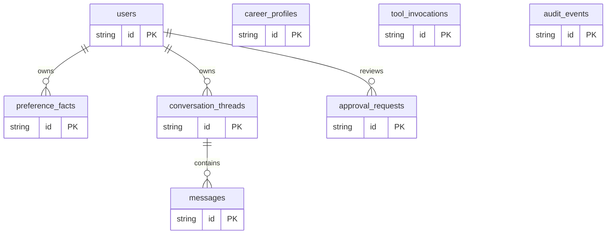

# Implemented data model

This diagram shows implemented tables only. See source for actual field types and keys; gate_policies and index_state use integer singleton keys. Full master-prompt normalization remains pending where documented in README. No invented schema is presented as implemented.
