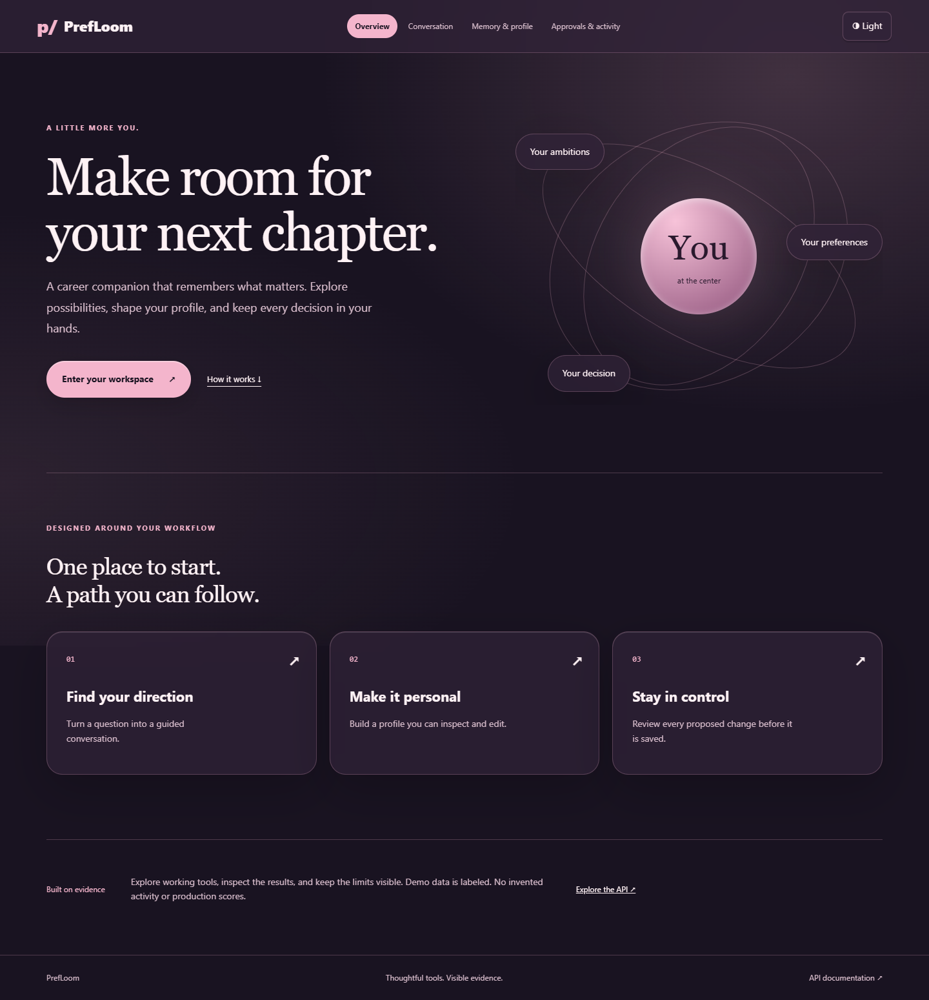
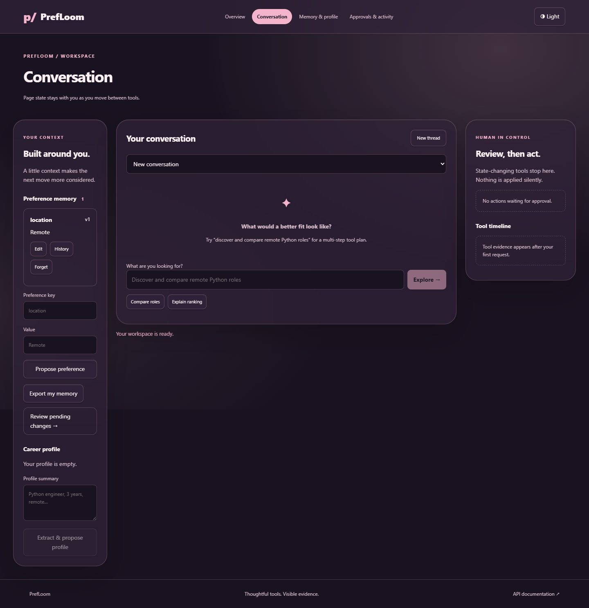

# Frontend redesign — 25 November 2026

## Distinct product identity

Rose / plum, editorial serif, orbital illustration.

Pages: Overview, Conversation, Memory & profile, Approvals & activity.

Additional controls: Memory/profile JSON export; direct approval navigation.

Routes use URL hash navigation and support direct links/reloads without colliding with backend API paths. The stateful workspace stays mounted during navigation; credentials are not placed in URLs. The landing page does not initialize a workspace until opened. Existing working API workflows remain available.

## Verification

- TypeScript, ESLint, frontend unit tests and Vite build passed.
- Full local Chrome workflow passed after the redesign, including the added page navigation and export checks.
- Landing and workspace layouts checked at 390px; no horizontal overflow in the tested views.
- Production Chrome checks passed: landing, direct links and reloads for each dedicated page, theme switching, and the existing application workflow.
- No JavaScript page errors observed in the production journey.
- New production landing/workspace screenshots and local light/mobile screenshots captured.
- Initial PrefLoom mobile check found an overflowing decorative orbit. The illustration was contained; new regression assertions and production rerun passed.

Phase implementation commit: `6766682`. That phase was pushed before proceeding to the next project. The final verification phase publishes these reports and refreshed screenshots separately.

These are frontend checks. Earlier database, model and Docker evidence remains in TEST_REPORT.md; this redesign does not create new benchmark scores or change the evaluated provider's quality gate.

[Mobile landing](assets/landing-mobile.png)
