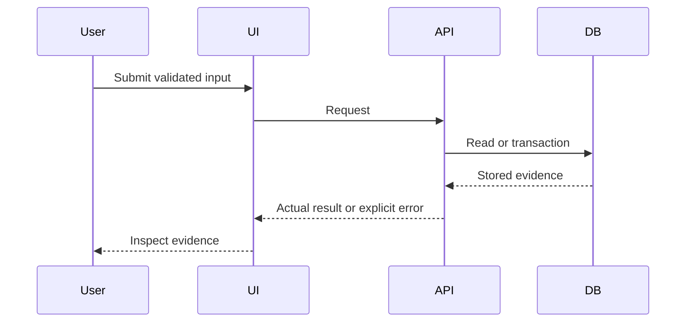

# Workflows

1. LangGraph intent, retrieval, execution and Pydantic validation nodes.
2. Hashed bearer demo sessions and per-user query scoping.
3. Preference proposal, approval/rejection, version increments and forgetting.
4. Stored conversations, tool invocation records and audit events.
5. Synthetic opportunity search, comparison, ranking explanation and SSE endpoint.

The full acceptance workflow remains in MASTER_PROMPT.md. A native success does not establish Docker, cloud or provider success.
